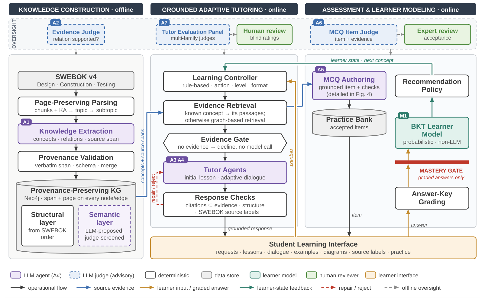
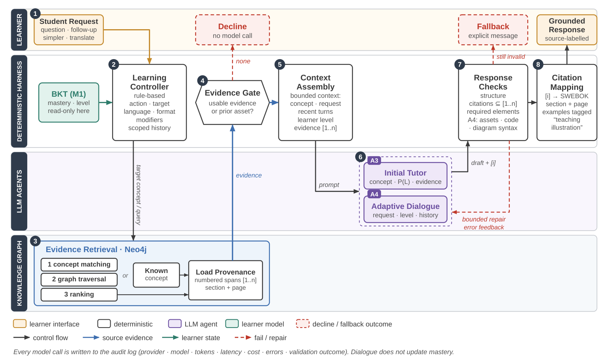
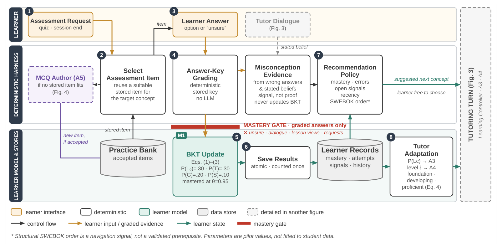
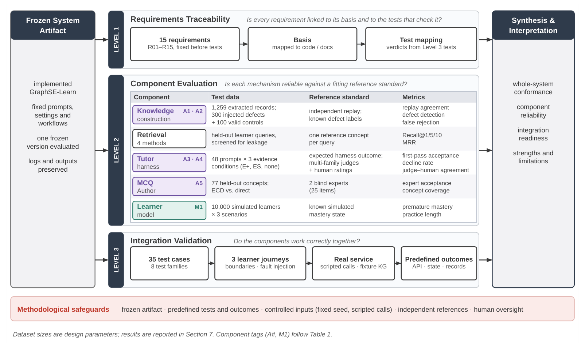

# GraphSE-Learn

**Design and Evaluation of an Evidence-Grounded Agentic GraphRAG System for Software Engineering Education**

**Bushra Salama Aljohani, Abdulaziz A. Alhubaishy, and Abdulmajeed Aljuhani**

Executable reference implementation accompanying the GraphSE-Learn research manuscript.

GraphSE-Learn connects software engineering concepts to their source evidence, uses specialized agents to generate tutoring and assessment content, and assigns workflow control, grading, and mastery updates to deterministic components. The manuscript studies technical reliability; student learning outcomes remain a separate empirical question.

The study uses SWEBOK v4 knowledge from **Software Design, Software Construction, and Software Testing**. This repository illustrates the architecture with a **synthetic corpus and scripted model responses**, so the demonstration runs offline without API keys. It is a compact reference implementation, not the frozen deployed system evaluated in the paper, and does not reproduce the reported experiments or include the SWEBOK corpus.

## Architecture



*Figure 1 from the manuscript.* [Vector PDF](docs/figures/fig1-overview.pdf). The architecture connects three stages, with advisory evaluation and human oversight shown separately from operational control.

1. **Offline knowledge construction:** page-preserving parsing, concept and relation extraction (A1), deterministic provenance validation, canonicalization, and advisory evidence judging (A2). The graph distinguishes source-derived structural relations from model-proposed semantic relations. Each accepted semantic record retains its source evidence.
2. **Online grounded adaptive tutoring:** a deterministic Learning Controller resolves the request, selects evidence and bounded context, invokes the Initial Tutor (A3) or Adaptive Dialogue Tutor (A4), and checks response structure and citation references. A known concept resolves directly to its source passages; open queries can use concept matching, graph traversal, ranking, and provenance lookup.
3. **Online assessment and learner modeling:** the MCQ Author (A5) supplies questions when suitable stored items are unavailable. Stored answer keys determine grades. Only graded answers update the non-LLM BKT learner model (M1), which informs subsequent tutoring and recommendations.

### Components in the paper

| ID | Component | Role and coverage here |
|---|---|---|
| A1 | Knowledge Extraction | Offline generator; the demo consumes synthetic extraction proposals. |
| A2 | Evidence Judge | Offline advisory judge; a judge hook is available in graph construction. |
| A3 | Initial Tutor | Evidence-backed initial lesson through the agent harness. |
| A4 | Adaptive Dialogue Tutor | Follow-up instruction using learner level and bounded context. |
| A5 | MCQ Author | Direct question generation with deterministic validation. |
| A6 | MCQ Item Judge | Advisory judge in the separately evaluated ECD variant; not implemented here. |
| A7 | Tutor Evaluation Panel | Offline multi-family evaluation; not implemented here. |
| M1 | BKT Learner Model | Probabilistic learner model updated by graded answers. |

The manuscript's A6/A7 evaluation workflows and deployed services are depicted for architectural context; their appearance in a figure does not imply that they are included in this package.

## Grounded tutoring and controlled generation



*Figure 3 from the manuscript.* [Vector PDF](docs/figures/fig3-tutoring-turn.pdf).

The harness controls model inputs and checks structured outputs. Citation indices must refer to the supplied evidence; generated examples and other teaching assets remain distinguishable from source passages. Requests without usable evidence are declined without a model call. Invalid outputs receive bounded repair attempts and an explicit fallback if repair fails. Dialogue supplies instructional context but does not update mastery.

These checks establish structural compliance and traceability. They do not independently establish that a passage semantically supports every generated claim, a limitation examined directly in the manuscript.

## Assessment, adaptation, and mastery



*Figure 5 from the manuscript.* [Vector PDF](docs/figures/fig5-mastery-loop.pdf).

The learner model applies standard Bayesian Knowledge Tracing after each graded answer, using pilot parameters `P(L0)=0.30`, `P(T)=0.30`, `P(G)=0.20`, and `P(S)=0.10`. The mastery threshold is **0.95**; the recommendation policy uses a separate attention cutoff of **0.60**. These are pilot settings, not estimates fitted to student data.

Unsure responses, dialogue, lesson views, and requests do not update mastery. Misconception signals guide instruction and recommendations without directly changing BKT. Source order supplies navigation rather than a validated prerequisite relation. Learners remain free to choose their next concept.

## Technical evaluation in the manuscript



*Figure 6 from the manuscript.* [Vector PDF](docs/figures/fig6-evaluation.pdf).

The paper evaluates a single frozen system at three levels:

- **Requirements traceability:** architectural requirements mapped to their code or documentation basis and integration tests.
- **Component evaluation:** knowledge construction, retrieval comparisons, tutor evidence controls, MCQ generation, learner-model simulation, and agreement between automated and human judgments.
- **Integration validation:** controlled learner workflows, boundary cases, and fault injection across components.

The study distinguishes structural reliability from semantic grounding and technical performance from educational effectiveness. The synthetic demo and unit tests in this repository demonstrate implementation contracts; they are not the manuscript's evaluation dataset or its experimental results.

## Quick start

Python 3.10 or later. The framework itself has no third-party runtime dependencies.

```bash
git clone https://github.com/bushra-aljohani/graphse-framework.git
cd graphse-framework
python examples/demo.py
```

To run the tests with pytest installed:

```bash
python -m pytest -q -p no:cacheprovider
```

The demo constructs a synthetic graph, displays provenance-gate rejections, compares graph, BM25, and fused retrieval, and runs a learning session through tutoring, assessment, grading, and recommendations. Model output is scripted; no external service is called.

## Repository guide

| Path | Purpose |
|---|---|
| `graphse/knowledge/` | Document and concept layers, provenance gate, canonicalization, advisory judge hook, relation filtering, and structural edges. |
| `graphse/retrieval/` | Provenance lookup, graph retrieval, BM25, and reciprocal-rank fusion. |
| `graphse/agents/` | Provider-independent model interface, bounded validation/repair harness, tutor agents, request resolution, and MCQ author. |
| `graphse/assessment/` | Practice bank, assessment attempts, and deterministic answer-key grading. |
| `graphse/learner/` | BKT, learner levels, diagnostic signals, and recommendations. |
| `graphse/orchestration/` | Deterministic Learning Controller and session workflow. |
| `graphse/store.py` | In-memory learner storage and transactions for the reference implementation. |
| `examples/` | Synthetic corpus, extraction proposals, and offline demonstration. |
| `tests/` | Executable checks of reference implementation behavior. |
| `docs/figures/` | Manuscript figures in PNG and vector PDF formats. |

### Extending the reference implementation

Implement the `LLMClient` protocol (`complete(system, messages, temperature) -> str`, returning JSON) and the `Embedder` protocol (`embed(text) -> list[float]`) for real model providers. The agents do not depend on a provider SDK.

The deployed system described in the paper uses a web interface, backend services, Neo4j and relational persistence. Those services, authentication, production logging, experimental datasets, multilingual support, and the ECD assessment variant are outside this compact package. Retrieval weights are illustrative defaults.

### Optional relation-review queue

By default, high-impact and inferred relations are excluded from the reference graph. `build_graph(..., keep_review_queue=True)` retains them in `kg.review_queue` for an optional human-review workflow. This review option was **not used or evaluated in the study**; held relations were not added to the study graph.

## License

MIT License. Copyright (c) 2026 Bushra Salama Aljohani, Abdulaziz A. Alhubaishy, and Abdulmajeed Aljuhani.
